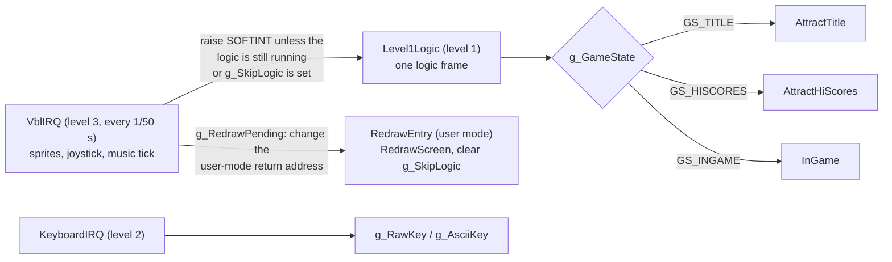
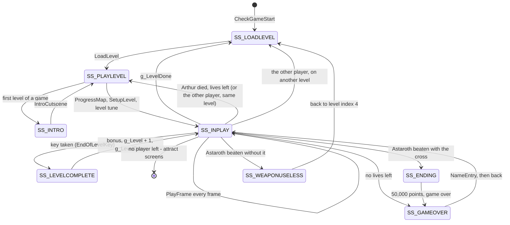
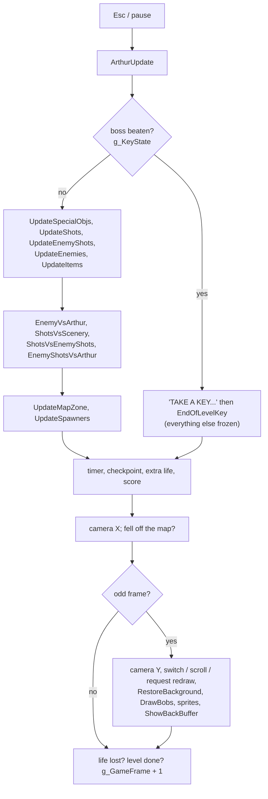
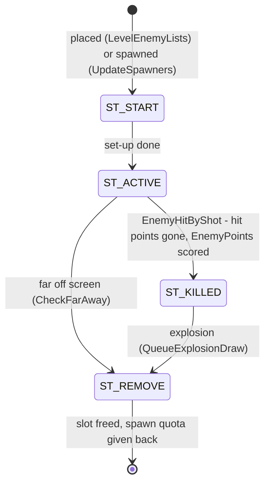
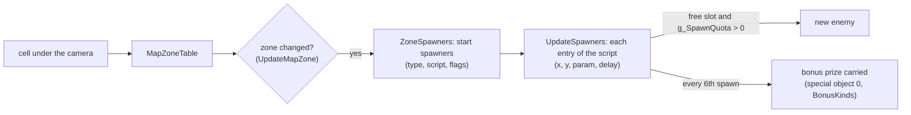
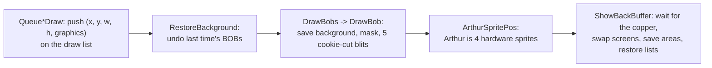
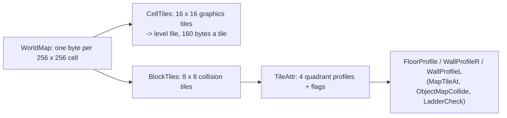

# How the game works

A guided tour of the main program, with the routine names to search for in `gng_main.s`.
Diagrams are Mermaid (they render on GitHub and in most Markdown viewers).

## 1. Everything runs in interrupts

After `Start` has loaded the common files and set up the hardware, the CPU drops to user
mode and spins in `IdleLoop`. The game itself runs in three interrupts:

The logic runs up to 50 times a second; the camera and drawing happen on every second logic
frame (`PlayFrame`), so the screen updates at 25 frames a second.

## 2. The in-game state machine

`InGame` dispatches on `g_SubState` (constants `SS_...`); each state has its own steps in
`g_SubState2` / `g_SubState3`.

## 3. One frame of play (`PlayFrame`)

## 4. Objects

All moving things live in fixed slot arrays in the globals block, and share the `O_` field
layout (`docs/GLOBALS.md`):

| Array | Slots | Handler |
|---|---|---|
| `g_Enemies` | 40 x `$3C` | `UpdateEnemies` -> `EnemyTypeTable` (one handler per enemy type) |
| `g_EnemyShots` | 6 x `$1C` | `UpdateEnemyShots` |
| `g_Shots` (Arthur's) | 4 x `$26` | `UpdateShots` |
| `g_Items` | 30 x `$1C` | `UpdateItems` (triggers, scenery, platforms) |
| `g_SpecialObjs` | 2 x `$20` | `UpdateSpecialObjs` (bonus prizes, the key, cut-scene props) |
| `g_Spawners` | 16 x `$C` | `UpdateSpawners` (one per enemy type) |

An enemy's life:

## 5. Where enemies come from

`docs/SPAWNS.md` lists every level's zones and scripts.

## 6. Drawing a frame

The background is not scrolled pixel by pixel: `RedrawScreen` redraws the whole playfield
around a new 16-px tile origin in the background (user mode), and the hardware fine scroll covers
up to 16 px either way until the display switches to it (`CameraJump`). The exact rules are in the
source at the camera header in `PlayFrame`, and as a checked model in `tools/verify/camera.py`.

## 7. The level data

`render/out/worldmap_cells.png` shows the whole map with every cell number.

## 8. Checking it

`tools/verify/checks.py` runs pieces of the original program in a 68000 emulator and checks the
bug notes and the camera rules against what the code really does.
